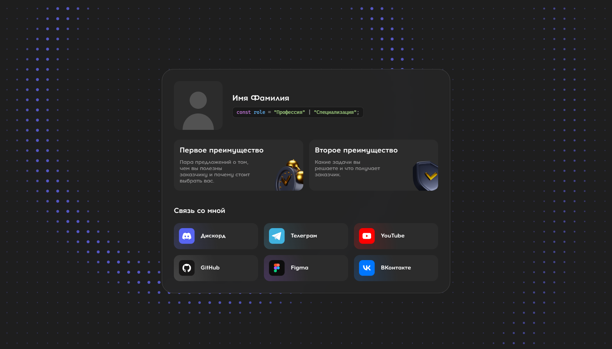

# Сайт-визитка / Card Site



[Русский](#русский) · [English](#english)

---

## Русский

Шаблон одностраничного сайта-визитки: аватар, имя, подпись, карточки с преимуществами и кнопки соцсетей на анимированном фоне. Вся информация на сайте — заглушки, их нужно заменить на свои.

Сделан на **Nuxt 4**, **Vue 3**, **Tailwind CSS 4** и **PrimeVue 4**.

### Быстрый старт

1. Установите [Node.js](https://nodejs.org/) версии **22.22.3+** или **24.15+** (LTS). npm ставится вместе с ним.
2. Откройте папку проекта в терминале и установите зависимости:

   ```bash
   npm install
   ```

3. Запустите сайт для разработки:

   ```bash
   npm run dev
   ```

   Сайт откроется на http://localhost:3000. Все правки подхватываются сразу, перезапуск не нужен.

4. Замените заглушки на свою информацию (см. ниже).
5. Соберите сайт и загрузите его на хостинг (см. «Сборка и публикация»).

### Где менять информацию

Всё, что видно на сайте, меняется в папке **`config/`** в корне проекта. Каждое поле в файлах подписано комментарием. Код трогать не нужно.

| Файл | Что в нём |
| --- | --- |
| `config/site.ts` | Домен, название во вкладке браузера, описание для поисковиков, картинка превью ссылки, иконка вкладки, ID Google Analytics |
| `config/profile.ts` | Имя, подпись под именем, аватар |
| `config/features.ts` | Карточки с преимуществами: заголовок, текст, картинка. Карточки можно добавлять и удалять |
| `config/contacts.ts` | Заголовок блока контактов, кнопки соцсетей, тексты уведомления «Скопировано» |

#### Имя, подпись и аватар — `config/profile.ts`

- `name` — имя крупным шрифтом.
- `role` — подпись под именем. На сайте она выглядит как строчка кода: `const role = "Профессия" | "Специализация";`. Части разделяются символом `|`, каждая становится отдельной строкой в кавычках.
- `avatar` — путь к картинке, например `/images/avatar.png`. Лучше квадратная, можно gif.

#### Карточки — `config/features.ts`

Каждая карточка — блок `{ title, text, icon }`. Чтобы добавить карточку, скопируйте блок целиком. Чтобы удалить, удалите блок вместе с запятой после него. `icon` — картинка в правом нижнем углу, `''` — без картинки.

#### Кнопки соцсетей — `config/contacts.ts`

Доступны Discord, Telegram, YouTube, GitHub, Figma и ВКонтакте. У каждой кнопки три поля:

- `label` — подпись на кнопке;
- `url` — ссылка, должна начинаться с `https://`;
- `copyText` — текст, который копируется по клику (например, ник Discord).

Как кнопка ведёт себя на сайте:

- заполнен `url` — кнопка видна и открывает ссылку в новой вкладке;
- `url` пустой, заполнен `copyText` — кнопка видна, по клику текст копируется и появляется уведомление;
- оба поля пустые — кнопки на сайте нет совсем.

Порядок кнопок на сайте совпадает с порядком в файле.

#### Домен, SEO и аналитика — `config/site.ts`

- `domain` — только имя домена, например `example.com`. Можно вставить и полный адрес `https://example.com/`, лишнее уберётся само. Из домена сайт сам собирает адрес для превью ссылок и для поисковиков, а при сборке создаёт файл `CNAME` (нужен для GitHub Pages). Пусто — сайт работает, но превью ссылки будет без адреса и картинки.
- `title` и `description` — название во вкладке и описание для поисковиков и превью ссылки.
- `previewImage` — картинка превью ссылки в Telegram, VK, Discord (рекомендуется 1200×630). Работает, только если указан домен.
- `favicon` — иконка во вкладке браузера (`.svg`, `.png` или `.ico`).
- `googleAnalyticsId` — ID вида `G-XXXXXXXXXX`. Пусто — аналитика выключена.

Само поле `domain` только сообщает сайту его адрес. Чтобы сайт открывался по домену, привяжите домен в панели хостинга и пропишите DNS-записи у регистратора.

#### Картинки

Свои картинки кладите в `public/images`. В конфиге путь пишется от этой папки: файл `public/images/me.png` указывается как `/images/me.png`.

### Где менять внешний вид

Внешний вид в `config/` не входит, он задаётся в коде:

| Что | Где |
| --- | --- |
| Цвета, шрифт, градиенты кнопок, точки адаптивности, скорость блеска карточек | `app/assets/css/main.css` |
| Цвет точек фона | `app/app.vue`, атрибут `color` у `<SonarGrid>` |
| Остальные параметры фона: расстояние между точками, скорость и толщина волн, частота | значения по умолчанию в `app/components/SonarGrid.vue` |
| Яркость и ширина блеска на карточках | `app/components/FeatureCard.vue` |
| Цвета подсветки подписи «как код» | токены `--color-code-*` в `app/assets/css/main.css` |
| Иконки соцсетей | `public/images/<название>.svg` |

### Сборка и публикация

```bash
npm run generate
```

Готовый сайт появится в папке `.output/public`. Загрузите её содержимое на любой статический хостинг: GitHub Pages, Netlify, Vercel, Cloudflare Pages или обычный веб-сервер (nginx, Apache).

Посмотреть собранную версию локально:

```bash
npm run preview
```

### Структура проекта

```
config/                 информация на сайте (меняете вы)
public/images/          картинки и иконки
public/fonts/           шрифт Acrom
app/app.vue             страница, SEO и аналитика
app/app.config.ts       подключает файлы из config/ (менять не нужно)
app/components/         шапка, карточки, контакты, анимированный фон
app/plugins/            блокировка F12
app/assets/css/main.css стили, цвета, шрифты
shared/utils/domain.ts  обработка домена
nuxt.config.ts          настройки Nuxt и PrimeVue
docs/                   скриншот для README (на сайт не попадает)
```

### Лицензия

Шаблон можно бесплатно использовать и менять, делать на нём личные и коммерческие сайты, в том числе на заказ для клиентов. **Нельзя продавать сам шаблон** или его изменённую версию как шаблон, тему или стартовый набор. Обязательно сохраняйте файл `LICENSE` с указанием автора.

Шрифты, картинки и логотипы третьих лиц остаются под своими лицензиями. Полный текст — в файле [LICENSE](LICENSE).

Автор: [Lipton151002](https://github.com/Lipton151002)

---

## English

A one-page business card website template: avatar, name, tagline, feature cards and social buttons on an animated background. All content is placeholder text that you replace with your own.

Built with **Nuxt 4**, **Vue 3**, **Tailwind CSS 4** and **PrimeVue 4**.

### Quick start

1. Install [Node.js](https://nodejs.org/) **22.22.3+** or **24.15+** (LTS). npm comes with it.
2. Open the project folder in a terminal and install dependencies:

   ```bash
   npm install
   ```

3. Start the development server:

   ```bash
   npm run dev
   ```

   The site opens at http://localhost:3000. Changes are applied instantly, no restart needed.

4. Replace the placeholders with your own information (see below).
5. Build the site and upload it to your hosting (see "Build and deploy").

### Where to change content

Everything visible on the site is edited in the **`config/`** folder in the project root. Every field there has a comment (in Russian). You don't need to touch the code.

| File | Contents |
| --- | --- |
| `config/site.ts` | Domain, browser tab title, search description, link preview image, favicon, Google Analytics ID |
| `config/profile.ts` | Name, tagline, avatar |
| `config/features.ts` | Feature cards: title, text, image. Cards can be added and removed |
| `config/contacts.ts` | Contacts section title, social buttons, "Copied" notification texts |

#### Name, tagline and avatar — `config/profile.ts`

- `name` — the large name at the top.
- `role` — the tagline under the name. It is rendered as a line of code: `const role = "Profession" | "Specialization";`. Parts are separated with `|`, each becomes a separate quoted string.
- `avatar` — image path, e.g. `/images/avatar.png`. A square image works best, gif is fine.

#### Feature cards — `config/features.ts`

Each card is a `{ title, text, icon }` block. To add a card, copy a whole block. To remove one, delete the block together with the comma after it. `icon` is the image in the bottom-right corner, `''` means no image.

#### Social buttons — `config/contacts.ts`

Discord, Telegram, YouTube, GitHub, Figma and VK are available. Each button has three fields:

- `label` — button text;
- `url` — link, must start with `https://`;
- `copyText` — text copied on click (e.g. a Discord username).

How a button behaves:

- `url` is set — the button is shown and opens the link in a new tab;
- `url` is empty, `copyText` is set — the button is shown, click copies the text and shows a notification;
- both are empty — the button is not rendered at all.

Buttons appear in the same order as in the file.

#### Domain, SEO and analytics — `config/site.ts`

- `domain` — just the domain name, e.g. `example.com`. A full URL like `https://example.com/` also works, extra parts are stripped. The site builds the link preview URL and canonical URL from it, and the build writes a `CNAME` file (used by GitHub Pages). Empty — the site works, but link previews have no URL or image.
- `title` and `description` — browser tab title and the description for search engines and link previews.
- `previewImage` — link preview image for Telegram, VK, Discord (1200×630 recommended). Works only when a domain is set.
- `favicon` — browser tab icon (`.svg`, `.png` or `.ico`).
- `googleAnalyticsId` — ID like `G-XXXXXXXXXX`. Empty — analytics is disabled.

The `domain` field only tells the site its address. To make the site open on your domain, connect the domain in your hosting panel and set up DNS records at your registrar.

#### Images

Put your images into `public/images`. In the config the path starts from that folder: `public/images/me.png` becomes `/images/me.png`.

### Where to change the look

Appearance is not part of `config/`, it lives in the code:

| What | Where |
| --- | --- |
| Colors, font, button gradients, breakpoints, card shine speed | `app/assets/css/main.css` |
| Background dot color | `app/app.vue`, the `color` attribute of `<SonarGrid>` |
| Other background settings: dot spacing, wave speed and width, frequency | default values in `app/components/SonarGrid.vue` |
| Card shine brightness and width | `app/components/FeatureCard.vue` |
| Code-style tagline colors | `--color-code-*` tokens in `app/assets/css/main.css` |
| Social icons | `public/images/<name>.svg` |

### Build and deploy

```bash
npm run generate
```

The finished site is written to `.output/public`. Upload its contents to any static hosting: GitHub Pages, Netlify, Vercel, Cloudflare Pages or a regular web server (nginx, Apache).

Preview the built site locally:

```bash
npm run preview
```

### Project structure

```
config/                 site content (edit this)
public/images/          images and icons
public/fonts/           Acrom font
app/app.vue             the page, SEO and analytics
app/app.config.ts       loads the files from config/ (no need to edit)
app/components/         header, cards, contacts, animated background
app/plugins/            F12 blocking
app/assets/css/main.css styles, colors, fonts
shared/utils/domain.ts  domain handling
nuxt.config.ts          Nuxt and PrimeVue settings
docs/                   README screenshot (not part of the site)
```

### License

You may use and modify the template for free and build personal and commercial websites with it, including websites for clients. **You may not sell the template itself** or a modified version of it as a template, theme or starter kit. Keep the `LICENSE` file with the author credit.

Third-party fonts, images and logos remain under their own licenses. Full text: [LICENSE](LICENSE).

Author: [Lipton151002](https://github.com/Lipton151002)
